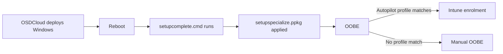

# Hand Off to Autopilot and OOBE

## When to use this

You want the deployed device to land **at OOBE ready for Intune /
Autopilot enrolment**, rather than at a workgroup-joined desktop. This is
the standard pattern for handing a freshly imaged device to an end user.

## Why this works

OSDCloud installs Windows but does not run OOBE — OOBE runs on the first
boot from disk. That gap is the natural integration point for Autopilot:



Autopilot enrolment requires the device's hardware hash to be uploaded to
Intune **before** OOBE. There are two common paths:

1. **Pre-registered devices** — vendor uploaded the hash at purchase. Just deploy and let OOBE find the profile.
2. **Self-registration** — deploy with a script that collects the hash and uploads it during the staging window. The `WindowsAutopilotIntune` and Microsoft Graph modules support this.

## Prerequisites

- An Intune tenant with an Autopilot deployment profile assigned.
- For self-registration: an app registration with the
  `DeviceManagementServiceConfig.ReadWrite.All` Graph permission.

## How OSDCloud sets up the handoff

Two pieces ship in the OSDCloud module:

| File | Role |
|---|---|
| `OSDCloud/core/setupspecialize/setupspecialize.ppkg` | Provisioning package applied at `Specialize` to set OOBE registry values |
| `OSDCloud/core/setupspecialize/setupspecialize.xml` | Source XML the PPKG was built from — edit this and rebuild the PPKG to customize |
| `OSDCloud/core/setupspecialize/customizations.xml` | Additional WCM customizations |

The OEM driver pack staging step (step 24) also writes commands into
`C:\Windows\Setup\Scripts\setupcomplete.cmd` so OEM drivers install
during Specialize without blocking OOBE.

## How to enable Autopilot-related modules on the deployed image

Steps 33–37 in the workflow stage PowerShell modules onto the offline
image so they are available at first boot. They ship with `"skip": true`.
Turn them on in `workflow/default/tasks/osdcloud.json` for the channel you use:

```jsonc
{ "name": "Save PowerShell Module WindowsAutopilotIntune",           "command": "step-powershell-savemodule", "parameters": { "name": "WindowsAutopilotIntune" },           "skip": false },
{ "name": "Save PowerShell Module Microsoft.Graph.Authentication",   "command": "step-powershell-savemodule", "parameters": { "name": "Microsoft.Graph.Authentication" },   "skip": false },
{ "name": "Save PowerShell Module Microsoft.Graph.Identity.DirectoryManagement", "command": "step-powershell-savemodule", "parameters": { "name": "Microsoft.Graph.Identity.DirectoryManagement" }, "skip": false },
{ "name": "Save PowerShell Module Microsoft.Graph.Groups",           "command": "step-powershell-savemodule", "parameters": { "name": "Microsoft.Graph.Groups" },           "skip": false }
```

After deployment those modules are in `C:\Program Files\WindowsPowerShell\Modules\`
and `Get-AutopilotInfo` is callable from a first-boot script.

## Pattern A — pre-registered device

1. Vendor (or your purchasing process) uploaded the hardware hash to Intune.
2. Deploy with OSDCloud normally:
   ```powershell
   Deploy-OSDCloud
   ```
3. Reboot.
4. OOBE starts → detects the matching Autopilot profile → enrols silently.

No extra customization is required.

## Pattern B — collect and upload hash from WinPE

Add a step to your main command (in a USB profile — see
[guide 6](06-unattended-usb-profile.md)) that runs after the deployment:

```jsonc
{
  "InvokeMainCommand": [
    "Show-OSDCloudDeviceInfo",
    "Deploy-OSDCloud -CLI",
    "https://raw.githubusercontent.com/contoso/autopilot/main/Register-DeviceWithIntune.ps1"
  ]
}
```

The registration script (your own) authenticates to Graph, calls
`Get-AutopilotInfo`, and posts to
`/deviceManagement/importedWindowsAutopilotDeviceIdentities`. After upload,
reboot — OOBE finds the profile.

## Pattern C — manual OOBE, no Autopilot

Just deploy. OOBE walks the operator through region, keyboard, network,
account. No additional configuration is needed.

## OSDCloudPreOOBE automated tasks (recast-winui-dark)

Only the two `recast-winui-dark` tasks enable `step-update-preoobe`. During WinPE
deployment it bundles [OSDCloudPreOOBE.ps1](../OSDCloud/core/preoobe/OSDCloudPreOOBE.ps1)
and its source components into a single standalone script in
`C:\Windows\Setup\Scripts` and **appends** a synchronous invocation as the last
block in `OOBE.cmd`, after the original commands.
No interactive invocation is added to `SetupComplete.cmd`: that hook is noninteractive.
Staging removes a previously managed SetupComplete menu block if present, leaving
all other content unchanged and not creating a missing SetupComplete script.
Original batch content is preserved byte-for-byte, with a separating newline added
if needed; repeated staging is idempotent. Earlier managed OOBE menu blocks are replaced.
An original `exit` or `goto :eof` can bypass the appended engine; staging warns about
these commands rather than rewriting the original control flow.
Other workflows do not enable this step.

The engine uses inbox Windows PowerShell 5.1 and WPF on AMD64 or ARM64; it does
not require the OSDCloud module, PowerShell 7, PsExec, ServiceUI, or downloads.
The batch invocation selects native Windows PowerShell (using Sysnative when
needed) and runs the equivalent of:

```cmd
"%SystemRoot%\System32\WindowsPowerShell\v1.0\powershell.exe" -NoLogo -NoProfile -STA -ExecutionPolicy Bypass -File "%SystemRoot%\Setup\Scripts\OSDCloudPreOOBE.ps1"
```

### Automatic sequence

The title is **Recast Software - OSDCloud PreOOBE** followed by the OSDCloud module
version (stamped into the staged script). On start it logs the running OS date, time and
time zone, then waits: nothing runs until the technician selects **Start**, so the
sequence can be presented in demos. Each task then shows a **Starting in 10 seconds**
countdown before it runs, giving clock changes time to apply and the technician time
to review or correct the clock. During a countdown the button reads **Start** and
starts that task immediately; while an update runs it reads **Skip Step**.

The collapsed left pane (select the hamburger to expand it) lists every task with a
checkbox. Unchecking a task before it starts skips it (logged as unchecked by
technician); checking it again before it is reached runs it. Checkboxes are disabled
once a task has started or finished.

Tasks run in this order:

1. **Driver unpack / install**: runs first because the OEM drivers may be required
   for network connectivity and time sync. The opted-in driver-download step stages
   `OSDCloudPreOOBE.DriverPack.json` beside the runtime instead of appending Lenovo
   or Surface installation commands to SetupComplete. The engine validates the local
   package path, manufacturer, extension, size and SHA-256 before execution.
   Lenovo uses the existing `/SILENT /SUPPRESSMSGBOXES` extraction method with
   `/NORESTART`, then PnPUtil adds/installs recursive INF drivers from `C:\Drivers`.
   An existing destination is rejected before extraction to avoid mixing unrelated
   drivers. No INF files means failure; extracted content is retained for diagnostics.
   Surface MSI uses `/qn /norestart` with verbose MSI logging. Exit 3010 records
   a reboot requirement but does not reboot. Artifacts are retained for diagnostics.
   No staged manifest means **NotApplicable**.
2. **Synchronizing internet time**: retrieve Google's HTTP `Date` header and set
   the system clock before any HTTPS connectivity checks or Windows Update work.
   This follows the existing OSDCloud time-source convention using HTTP to avoid
   the incorrect-clock/certificate bootstrap problem. Two attempts have five-second
   request budgets. Redirects, missing dates and stale cached responses are rejected.
   The internet UTC time is converted to the running OS time zone before it is applied
   (Windows PowerShell `Set-Date` sets local time and ignores `DateTimeKind`).
   The UTC correction, applied local time and verified resulting clock are logged; the
   time zone is unchanged. Failure is reported explicitly and independent tasks continue.
   HTTP time is unauthenticated: use a trusted deployment network. This does not
   disable certificate validation for connectivity probes or Windows Update.
3. **Updating Windows 11**: check connectivity, then scan/download/install applicable
   software updates (including Windows servicing and .NET). If this task **fails**,
   the sequence pauses: use the title-bar calendar to verify Date, Time and TimeZone,
   then select **Retry** (runs it again after the 10-second countdown) or **Continue**.
   The pause has no timeout; closing the window skips the remaining tasks.
4. **Updating Drivers**: check connectivity again, then scan/download/install
   applicable driver updates.

The update actions honor configured Windows Update/WSUS policies, exclude hidden/
Preview updates and updates requiring interactive input, and accept EULAs.
No third-party module is imported and update-service settings are not changed.
There are no per-update Skip buttons. **Skip Step** cooperatively cancels the
active update after its current WUA operation. The next independent task still runs.
OEM installation cannot be force-cancelled. There is no forced installation timeout.

Failures are logged and shown explicitly as a short message; full exception details and
stack traces are written only to `OSDCloudPreOOBE.log`. The engine continues independent tasks.
After all tasks reach terminal states, a **Continue to OOBE** button appears; selecting
it closes the window with **exit 0**, allowing Windows Setup to continue. There is no
automatic continuation, so PreOOBE requires a technician. No task automatically reboots.
Close/Escape/Alt+F4 requests safe completion of the active OEM operation or cancellation
of the active update, skips remaining tasks, and then continues setup.
Startup failure returns nonzero; the batch reports/logs it and continues.

### Connectivity and future wireless recovery

Before each update, the Windows NCSI probe `http://www.msftconnecttest.com/connecttest.txt`
must return the exact `Microsoft Connect Test` content. It does not follow redirects
or accept portal pages. HTTPS certificate validation is then checked against
`https://sls.update.microsoft.com/` (any HTTP status means TLS succeeded).
`https://www.msftconnecttest.com` is not used: it serves an Akamai certificate
(`a248.e.akamai.net`), so it fails validation with a name mismatch even when the
clock is correct. Two attempts have five-second request budgets and a 64-byte response
limit. The probe uses the SYSTEM default proxy and never changes network policy.

When the HTTPS check fails with a certificate error, troubleshooting is logged:

- **TLS diagnostic**: the clock (local, UTC, time zone), W32Time and Hyper-V
  time-sync service state, proxy, DNS, root store counts, and a handshake that records
  the SSL policy errors, server certificate, chain elements and chain status.
  The diagnostic never trusts an invalid certificate.
- **Clock shift test** (SYSTEM only): the clock is set 1 hour forward and probed,
  then 1 hour back and probed, and then restored (always, including on errors) and
  probed again. Calendar Apply is blocked while the test runs. Results are
  diagnostic only; if the restored probe connects, the update continues.
Unavailable internet or a failed probe marks that update **Skipped**, with the reason
logged. Local driver installation and the remaining tasks still proceed.
Cancellation is checked between attempts; an in-flight probe may take up to its timeout.

This probe does not guarantee WU/WSUS availability; service-specific failures are still
reported by WUA. Blocking the Microsoft probe can cause offline skips even when other
sites work. An internet-isolated device with reachable WSUS is deliberately skipped
under this internet prerequisite.

A **Wireless Connection wizard is planned, not shipped**. The future optional step
will be offered only after failed connectivity and detection of Wi-Fi hardware, after
OEM drivers have installed. It must not block unattended continuation. The design uses
inbox Native Wi-Fi APIs, saved profiles first, bounded Connect/Skip/Cancel behavior,
and no credential/profile-key logging. New-profile security and persistence policies
need validation before implementation; no WinPE wireless tool is installed here.

### Technician tools and display

The window opens 20 device-independent pixels inward from the top-left of the primary
work area (reduced when needed to keep the window on-screen), with BootMenu-style
caption controls and task progress. Output fills the available height with internal
scrolling. The window stays topmost so ordinary
Windows Setup windows cannot cover it; minimize it when working in a launched shell.

- The title-bar **Shell** menu offers **CMD Prompt** and **Windows PowerShell**,
  opening independent SYSTEM shells.
- The title-bar **Scripts** menu opens **OOBE.cmd** and **SetupComplete.cmd** in Notepad.
  Save edits before continuing. Windows command processing may already have read
  parts of the current batch file; do not assume editing it changes the active run.
- The title-bar calendar icon opens **Date, Time & TimeZone**. Select a local
  calendar date, enter 24-hour `HH:mm:ss`, select a Windows time zone, then **Apply**.
  The selected zone is applied first, then the chosen local time is applied as local
  time in that zone. Input is validated before changes; daylight-saving
  gaps/repeated hours are rejected. Errors remain visible. If setting the time
  fails after the time zone changed, inspect the clock/zone before retrying. Applying
  clock changes is disabled during time synchronization, clock testing and active
  installation.
- The status bar shows only the running OS date and time in the OS locale's full format
  with the time zone name and UTC offset, refreshed every second.
- The title-bar person icon shows the running account (**SYSTEM**) on hover.
- The window resizes from an 8-pixel border around its edges.
- Shell and Notepad windows remain open after the engine closes and are not waited on.
- Tool errors remain visible and are logged without stopping task execution.

**Security:** this is a technician feature that deliberately exposes SYSTEM
shells, setup script editing, clock changes, and update installation. Disable the
engine for end-user deployments by setting
`"skip": true` on `step-update-preoobe` in the selected dark-workflow task
**before deployment**. Editing the task afterward does not remove an already
staged invocation. Driver handoff requires both the explicit `PreOOBE` parameter
and an enabled staging step; when disabled, original SetupComplete driver handling remains.

Diagnostics are in `%SystemRoot%\Temp\osdcloud-logs\OSDCloudPreOOBE.log`, including
identity/session/desktop, package validation, task transitions/durations, connectivity
failures, process IDs/exit codes, WUA identities/results/HRESULTs, cancellation,
reboot requirements, technician Start/skip selections and final exit.
`OSDCloudPreOOBE-results.json` records terminal task outcomes; `PreOOBE-*.stdout.log`,
`PreOOBE-*.stderr.log` and Surface MSI logs preserve installer diagnostics.
Setup's own logs can be consulted to establish the actual hook/order.
SYSTEM alone does not imply a visible desktop. If necessary, the script launches
itself as SYSTEM in the active console session and attaches to that session's
input desktop before loading WPF. It does not force a desktop switch, log on a
user, or change OOBE configuration. A child that cannot acknowledge a
rendered window on the console input desktop within 60 seconds fails instead of leaving an invisible menu blocking
setup. The render log records activation,
topmost state and window bounds; rendering alone does not prove operator visibility
if Windows subsequently changes desktops. The menu does not force a desktop switch.

For an inert **local console** preview, use:

```powershell
powershell.exe -NoLogo -NoProfile -STA -File .\OSDCloud\core\preoobe\OSDCloudPreOOBE.ps1 -Preview
```

Preview simulates the sequence (including Start, step checkboxes and Continue to OOBE)
without network, driver/update installations,
shell launches or clock writes. Logs and results go to `%TEMP%`. It does **not**
verify first-boot behavior.

**Deployment validation is required:** this repository creates `OOBE.cmd`, but
that file's presence alone does not establish whether/when the installed Windows
build invokes it, or prove an interactive setup desktop is available. Validate
the actual SYSTEM hook on disposable AMD64 and ARM64 Windows 11 installations:
the menu must be visible and keyboard/mouse interactive, setup must wait while
it is open, both shells must work, and closing with shells still open must allow
setup to proceed normally. Also test missing assets and unavailable desktops.
Confirm the engine runs after original OOBE commands and that SetupComplete has
no managed menu invocation. Verify date, time and time zone changes and normal continuation.
Test both update actions on disposable Windows 11 devices with working network
access, including no-updates results, failures, reboot-required results, cancellation
and menu closure during an update. Local mocks/preview do not verify actual WUA
installation during SYSTEM OOBE.
Validate real Lenovo/Surface installation, offline skips and safe cancellation.
Collect `OSDCloudPreOOBE.log`, results/installer logs, the staged `OOBE.cmd` and `SetupComplete.cmd`,
`C:\Windows\Panther\setupact.log`, and
`C:\Windows\Panther\UnattendGC\setupact.log` if a menu does not appear or setup
does not continue. SetupComplete can be disabled by Windows for OEM product keys
on non-Enterprise client editions; staging its file does not override that restriction.
No AMD64/ARM64 first-boot verification is implied by the desktop preview or mocks.
If the selected build does not invoke this hook, the menu will not appear;
do not silently substitute first logon for the requested setup hooks.

## Customize OOBE settings

Edit the source XML, rebuild the PPKG with the Windows Configuration Designer,
and replace `OSDCloud/core/setupspecialize/setupspecialize.ppkg`. Common
edits:

- Skip the EULA page (the `Hotfix for Setup Displayed Eula` workflow step already sets `SetupDisplayedEula = 1` so this is normally handled).
- Set a default keyboard or time zone before OOBE shows.
- Disable Cortana / privacy pages for kiosk scenarios.

## What this guide is **not**

A complete Autopilot setup guide. For Intune profile creation, assignment
groups, and ESP behaviour see:

- [Microsoft Learn — Windows Autopilot deployment](https://learn.microsoft.com/autopilot/)
- [Microsoft Learn — Enrolment Status Page](https://learn.microsoft.com/autopilot/enrollment-status)

## Next

- [Troubleshoot](09-troubleshooting.md) if the device lands at OOBE without joining Intune.
