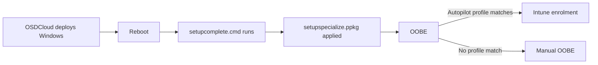

# Hand Off to Autopilot and OOBE

## When to use this

You want the deployed device to land **at OOBE ready for Intune /
Autopilot enrolment**, rather than at a workgroup-joined desktop. This is
the standard pattern for handing a freshly imaged device to an end user.

## Why this works

OSDCloud installs Windows but does not run OOBE — OOBE runs on the first
boot from disk. That gap is the natural integration point for Autopilot:



Autopilot enrolment requires the device's hardware hash to be uploaded to
Intune **before** OOBE. There are two common paths:

1. **Pre-registered devices** — vendor uploaded the hash at purchase. Just deploy and let OOBE find the profile.
2. **Self-registration** — deploy with a script that collects the hash and uploads it during the staging window. The `WindowsAutopilotIntune` and Microsoft Graph modules support this.

## Prerequisites

- An Intune tenant with an Autopilot deployment profile assigned.
- For self-registration: an app registration with the
  `DeviceManagementServiceConfig.ReadWrite.All` Graph permission.

## How OSDCloud sets up the handoff

Two pieces ship in the OSDCloud module:

| File | Role |
|---|---|
| `OSDCloud/core/setupspecialize/setupspecialize.ppkg` | Provisioning package applied at `Specialize` to set OOBE registry values |
| `OSDCloud/core/setupspecialize/setupspecialize.xml` | Source XML the PPKG was built from — edit this and rebuild the PPKG to customize |
| `OSDCloud/core/setupspecialize/customizations.xml` | Additional WCM customizations |

The OEM driver pack staging step (step 24) also writes commands into
`C:\Windows\Setup\Scripts\setupcomplete.cmd` so OEM drivers install
during Specialize without blocking OOBE.

## How to enable Autopilot-related modules on the deployed image

Steps 33–37 in the workflow stage PowerShell modules onto the offline
image so they are available at first boot. They ship with `"skip": true`.
Turn them on in `workflow/default/tasks/osdcloud.json` for the channel you use:

```jsonc
{ "name": "Save PowerShell Module WindowsAutopilotIntune",           "command": "step-powershell-savemodule", "parameters": { "name": "WindowsAutopilotIntune" },           "skip": false },
{ "name": "Save PowerShell Module Microsoft.Graph.Authentication",   "command": "step-powershell-savemodule", "parameters": { "name": "Microsoft.Graph.Authentication" },   "skip": false },
{ "name": "Save PowerShell Module Microsoft.Graph.Identity.DirectoryManagement", "command": "step-powershell-savemodule", "parameters": { "name": "Microsoft.Graph.Identity.DirectoryManagement" }, "skip": false },
{ "name": "Save PowerShell Module Microsoft.Graph.Groups",           "command": "step-powershell-savemodule", "parameters": { "name": "Microsoft.Graph.Groups" },           "skip": false }
```

After deployment those modules are in `C:\Program Files\WindowsPowerShell\Modules\`
and `Get-AutopilotInfo` is callable from a first-boot script.

## Pattern A — pre-registered device

1. Vendor (or your purchasing process) uploaded the hardware hash to Intune.
2. Deploy with OSDCloud normally:
   ```powershell
   Deploy-OSDCloud
   ```
3. Reboot.
4. OOBE starts → detects the matching Autopilot profile → enrols silently.

No extra customization is required.

## Pattern B — collect and upload hash from WinPE

Add a step to your main command (in a USB profile — see
[guide 6](06-unattended-usb-profile.md)) that runs after the deployment:

```jsonc
{
  "InvokeMainCommand": [
    "Show-OSDCloudDeviceInfo",
    "Deploy-OSDCloud -CLI",
    "https://raw.githubusercontent.com/contoso/autopilot/main/Register-DeviceWithIntune.ps1"
  ]
}
```

The registration script (your own) authenticates to Graph, calls
`Get-AutopilotInfo`, and posts to
`/deviceManagement/importedWindowsAutopilotDeviceIdentities`. After upload,
reboot — OOBE finds the profile.

## Pattern C — manual OOBE, no Autopilot

Just deploy. OOBE walks the operator through region, keyboard, network,
account. No additional configuration is needed.

## OSDCloudSetupComplete silent scripts (recast)

The two `recast` tasks enable `step-update-setupcomplete`. During
WinPE deployment it validates and copies the standalone
[OSDCloudSetupComplete module](../OSDCloud/core/modules/OSDCloudSetupComplete)
to `C:\Windows\Setup\Modules\OSDCloudSetupComplete`, stamps its version from
OSDCloud, and appends a synchronous, noninteractive invocation to
`C:\Windows\Setup\Scripts\SetupComplete.cmd`.

The hook explicitly imports the staged manifest and calls
`Invoke-OSDCloudSetupComplete`. Import alone is inert; the runtime has no
dependency on the parent OSDCloud module or PowerShell 7. It requires SYSTEM
in full Windows using inbox Windows PowerShell 5.1, with AMD64 and ARM64
native PowerShell selected by the hook. There is no GUI, Start button,
confirmation, driver/update task, or automatic reboot.

Existing batch commands, including OEM driver commands, remain before the
appended hook. Repeated staging replaces only the new runner's managed block.
Its markers are distinct from the legacy SetupComplete menu markers removed
by PreOOBE staging. Early `exit` or `goto :eof` commands are preserved and
warned about; they may prevent the appended runner from executing.

### Package discovery and configuration

The runtime searches immediate package folders in this order:

1. `%SystemRoot%\Setup\SetupComplete`
2. `A:\OSDCloud\core\SetupComplete` through `Z:\OSDCloud\core\SetupComplete`

Folders are sorted by name within each root. Prefix names with numbers to
control order within that root. Identically named folders on different drives
are separate packages; all eligible packages run sequentially.

Each package requires `OSDCloudSetupComplete.json`. Folders without this file
are logged and skipped; no arbitrary script or PSADT fallback is used.

```text
G:\OSDCloud\core\SetupComplete\010-ConfigureAgent\
    OSDCloudSetupComplete.json
    ConfigureAgent.ps1
    AgentSettings.json
```

```json
{
    "Version": 1,
    "Name": "Configure agent",
    "Script": "ConfigureAgent.ps1",
    "Arguments": "-SettingsFile \"AgentSettings.json\"",
    "Enabled": true,
    "CopyToLocal": false,
    "Conditions": {
        "ComputerManufacturer": "Dell*",
        "ComputerModel": ["Latitude*", "Precision*"],
        "OSArchitecture": ["amd64", "arm64"]
    }
}
```

| Field | Required | Behavior |
|---|---|---|
| `Version` | Yes | Integer `1` |
| `Script` | Yes | Existing `.ps1` filename directly inside the package folder; no directory components |
| `Name` | No | Nonempty label; defaults to the folder name |
| `Arguments` | No | Literal single-line Windows command-line string; defaults to no arguments |
| `Enabled` | No | Boolean, defaults to `true`; false logs a skip |
| `CopyToLocal` | No | Boolean, defaults to `false`; copies the entire package before execution |
| `Conditions` | No | Same manufacturer/model/native architecture conditions as PreOOBE |

Conditions use AND across fields, OR across strings in an array, and
case-insensitive manufacturer/model wildcards. `OSArchitecture` accepts `amd64`
or `arm64`, based on the installed OS rather than an emulated process.
Disabled packages and condition nonmatches are skips. Invalid configurations,
missing scripts, unavailable required device facts, rooted/escaping paths,
alternate streams, and reparse points along the entry-script path are failures.
Other packages and roots are still processed.

The actual `.ps1` runs in a separate `-NoProfile -NonInteractive -File` Windows
PowerShell process. Both `$PSScriptRoot` and the working directory are the package
folder. Use `Join-Path $PSScriptRoot 'AgentSettings.json'` to access supporting
content. Arguments are not evaluated as PowerShell expressions. Quote values
containing spaces with JSON escaping, as shown above.

With `CopyToLocal: true`, the whole folder is copied to
`%SystemRoot%\Temp\OSDCloudSetupComplete\<FolderName>`; later copies use `-2`,
`-3`, etc. Script root and working directory then point to the copy. Read-only
attributes are cleared only on the copied content. Packages with reparse points
in supporting content are refused before copying. Copies remain after success
or failure and are not automatically cleaned up.

The staging step copies the module, not external packages. Keep drive-hosted
packages attached and accessible during Windows Setup, or separately stage
them under the local Windows package root.

Five numbered manifest templates, a harmless companion script, and supporting
JSON are provided in the module's
[example directory](../OSDCloud/core/modules/OSDCloudSetupComplete/files).
The [packaging instructions](../OSDCloud/core/modules/OSDCloudSetupComplete/files/README.md)
explain how to rename a chosen template to `OSDCloudSetupComplete.json`.
Templates are not automatically discovered as tasks.

### Failure handling, logs, and validation

Scripts must run silently, wait for their own work, and never reboot. Use
`$ErrorActionPreference = 'Stop'`, and check and propagate native installer/tool
exit codes. A terminating error or explicit nonzero `exit` fails the child.
PowerShell `-File` does not automatically fail for nonterminating errors or
unchecked native failures. `-NonInteractive` prevents PowerShell prompts, but
cannot make third-party GUI installers silent.

Exit `0` succeeds; `3010` succeeds with a logged reboot requirement, without
restarting Windows. Other exit codes and launch/copy/discovery failures set the
overall result to `1`, but remaining packages continue. No failures, including
no eligible packages, return `0`. The function returns an integer without
exiting its caller; the batch-launched host converts it to a process exit code
and logs invocation failures. Every invocation runs eligible packages again:
write idempotent scripts. Concurrent runtime invocations are refused.

Diagnostics append to
`%SystemRoot%\Temp\osdcloud-logs\OSDCloudSetupComplete.log`. Each launched package
has unique `SetupComplete-<GUID>.stdout.log` and `.stderr.log` files in the same
directory, referenced in the runtime log with exit codes and elapsed time.
Do not include credentials in configuration or output. Packages are trusted
SYSTEM code, not sandboxed or signature-verified by this module.

Windows controls the timing and availability of SetupComplete; some OEM product
key scenarios suppress it. No scheduled-task fallback is installed, and no new
ordering relative to the separate PreOOBE hook is guaranteed. Validate on
disposable AMD64 and ARM64 deployments: verify the staged manifest and hook,
script-root/content access, ordering, failure continuation, and retained logs.
Mocked tests and local child-process tests do not establish that Windows Setup
invokes the hook on a particular installation.

## OSDCloudPreOOBE automated tasks (recast)

Only the two `recast` tasks enable `step-update-preoobe`. During WinPE
deployment it copies the entire standalone
[OSDCloudPreOOBE module](../OSDCloud/core/modules/OSDCloudPreOOBE) folder to
`C:\Windows\Setup\Modules\OSDCloudPreOOBE` and **appends** a synchronous import
and launch as the last block in `C:\Windows\Setup\Scripts\OOBE.cmd`, after the
original commands. The module exports `Invoke-OSDCloudPreOOBE` and its launch alias
`OSDCloudPreOOBE`; implementation helpers remain private. Import alone does not
open the window or run tasks. No standalone runtime is generated in Setup\Scripts,
and the old `core\preoobe` script path is no longer supported.
No interactive invocation is added to `SetupComplete.cmd`: that hook is noninteractive.
PreOOBE staging removes a previously managed SetupComplete menu block if present, leaving
all other content unchanged and not creating a missing SetupComplete script.
The separate `step-update-setupcomplete` step above installs the new silent
script runner, not an interactive menu.
Original batch content is preserved byte-for-byte, with a separating newline added
if needed; repeated staging is idempotent. Earlier managed OOBE menu blocks are replaced.
An original `exit` or `goto :eof` can bypass the appended engine; staging warns about
these commands rather than rewriting the original control flow.
Other workflows do not enable this step.

The engine uses inbox Windows PowerShell 5.1 and WPF on AMD64 or ARM64; it does
not require the OSDCloud module, PowerShell 7, PsExec, ServiceUI, or downloads.
The batch invocation selects native Windows PowerShell (using Sysnative when
needed) and runs the equivalent of:

```cmd
"%SystemRoot%\System32\WindowsPowerShell\v1.0\powershell.exe" -NoLogo -NoProfile -STA -ExecutionPolicy Bypass -Command "try { Import-Module -Name (Join-Path $env:SystemRoot 'Setup\Modules\OSDCloudPreOOBE\OSDCloudPreOOBE.psd1') -ErrorAction Stop; exit (OSDCloudPreOOBE) } catch { Write-Error -ErrorRecord $_ -ErrorAction Continue; exit 1 }"
```

The explicit manifest path avoids any dependence on `PSModulePath`. The launch
command returns a numeric status without exiting its caller; the batch-launched
PowerShell host converts that status to a process exit code. Import errors also
produce a nonzero exit code for the existing batch failure logging.

### Automatic sequence

The title is **Recast Software - OSDCloud PreOOBE** followed by the OSDCloud module
version (stamped into the copied module manifest). On start it logs the running OS date, time and
time zone, then waits: nothing runs until the technician selects **Start**, so the
sequence can be presented in demos. Each task then shows a **Starting in 10 seconds**
countdown before it runs, giving clock changes time to apply and the technician time
to review or correct the clock. During a countdown the button reads **Start** and
starts that task immediately; while an update runs it reads **Skip Step**.

**Start** is highlighted in cyan and receives keyboard focus when the window opens.
Use **Tab** / **Shift+Tab** to cycle through available actions, caption buttons,
task checkboxes (including applications), the task summary and output. **Space**
toggles a focused checkbox or activates a button; **Enter** activates Start.
Tools and Shell menus focus their first item on opening and support Tab and arrow
keys; Escape dismisses the menu. Focus outlines identify the current control.
When a focused action becomes unavailable, focus moves to an available action.
PreOOBE explicitly uses the standard-size arrow throughout its window and menus;
it does not load an enlarged pointer or change system pointer settings.
Verify pointer visibility and keyboard navigation on the actual OOBE
desktop; a preview cannot establish setup-desktop pointer rendering.

The left pane is expanded by default (select the hamburger to collapse it) and lists every task with a
checkbox. Unchecking a task before it starts skips it (logged as unchecked by
technician); checking it again before it is reached runs it. Checkboxes are disabled
once a task has started or finished.

Tasks run in this order:

1. **Driver unpack / install**: runs first because the OEM drivers may be required
   for network connectivity and time sync. The opted-in driver-download step stages
   `C:\Windows\Setup\Scripts\OSDCloudPreOOBE.DriverPack.json` instead of appending Lenovo
   or Surface installation commands to SetupComplete. The engine validates the local
   package path, manufacturer, extension, size and SHA-256 before execution.
   Lenovo uses the existing `/SILENT /SUPPRESSMSGBOXES` extraction method with
   `/NORESTART`, then PnPUtil adds/installs recursive INF drivers from `C:\Drivers`.
   An existing destination is rejected before extraction to avoid mixing unrelated
   drivers. No INF files means failure; extracted content is retained for diagnostics.
   Surface MSI uses `/qn /norestart` with verbose MSI logging. Exit 3010 records
   a reboot requirement but does not reboot. Artifacts are retained for diagnostics.
   No staged manifest means **NotApplicable**.
2. **Synchronizing internet time**: retrieve Google's HTTP `Date` header and set
   the system clock before any HTTPS connectivity checks or Windows Update work.
   This follows the existing OSDCloud time-source convention using HTTP to avoid
   the incorrect-clock/certificate bootstrap problem. Two attempts have five-second
   request budgets. Redirects, missing dates and stale cached responses are rejected.
   The internet UTC time is converted to the running OS time zone before it is applied
   (Windows PowerShell `Set-Date` sets local time and ignores `DateTimeKind`).
   The UTC correction, applied local time and verified resulting clock are logged; the
   time zone is unchanged. If synchronization fails, PreOOBE offers **Connect to
   Wi-Fi** when a physical wireless adapter is detected. After association it waits
   two seconds for DHCP/DNS and retries time synchronization once (again allowing
   two five-second HTTP attempts), before advancing to Windows Update. No HTTPS
   probe is required before this retry because the clock may still be incorrect.
   Skipping recovery, unavailable wireless hardware or a failed retry leaves the
   time task **Failed**; independent tasks continue. Cancellation stops recovery
   without another time request.
   HTTP time is unauthenticated: use a trusted deployment network. This does not
   disable certificate validation for connectivity probes or Windows Update.
3. **Updating Windows 11**: check connectivity, then scan/download/install applicable
   software updates (including Windows servicing and .NET). If this task **fails**,
   the sequence pauses: use **Shell** to verify the system date, time and time zone,
   then select **Retry** (runs it again after the 10-second countdown) or **Continue**.
   The pause has no timeout; closing the window skips the remaining tasks.
4. **Updating Drivers**: check connectivity again, then scan/download/install
   applicable driver updates.
5. **Custom applications**: when the window opens, discover immediate application
   folders containing `OSDCloudPreOOBE.json` or `Invoke-AppDeployToolkit.exe` under
   `%SystemRoot%\Setup\PreOOBE` and `<drive>:\OSDCloud\core\PreOOBE` on A: through Z:.
   The former drive-hosted `OSDCloud\PreOOBE` location is not searched or migrated;
   the local `%SystemRoot%\Setup\PreOOBE` path is unchanged.
   Local applications appear first, followed by drive-hosted applications in
   drive-letter order; folders within each root are sorted by name.
   Each eligible application appears below **Updating Drivers**, checked by default
   unless its manifest specifies otherwise. The label is the manifest name or
   folder name, with the drive appended for drive-hosted content,
   such as **My AppFolder [G:]**. Uncheck it before it starts to skip installation.
   Identically named applications in different roots remain separate tasks.
   Discovery is not recursive and does not download or copy packages.
   Each selected package runs sequentially from its application folder using
   its manifest command, or `-DeploymentType Install -DeployMode Silent` for
   PSADT-only packages, even if the connectivity probe failed.
   Exit 0 means success; exit 3010 records a reboot requirement; other
   exit codes are failures. A removed or unavailable executable is reported as a
   failed task, and remaining tasks continue. An active application cannot be
   force-cancelled: closing the window waits for its process tree to finish, then
   skips remaining tasks. Deploy only trusted packages configured not to reboot
   Windows; the runner does not override a package's own reboot behavior.

### Custom installers without PSADT

Put a file named **OSDCloudPreOOBE.json** beside your installer in an immediate
application folder under one of the search roots above. For example:

```text
G:\OSDCloud\core\PreOOBE\Workspace Agent\
    OSDCloudPreOOBE.json
    AgentBootstrapper.exe
    AgentRegistration.cer
```

```json
{
    "Version": 1,
    "Name": "Workspace Agent",
    "Executable": "AgentBootstrapper.exe",
    "Arguments": "--certificate AgentRegistration.cer --startDeployment --wait",
    "DefaultSelected": false
}
```

The working directory is the folder containing the manifest unless
`CopyToLocal` is `true`. The certificate argument above therefore resolves from
the package folder.
Use the installer's actual filename: the supplied Application Workspace package
uses `Liquit-Universal-Agent-Win-4.5.4374.7448.exe` instead of
`AgentBootstrapper.exe`. Neither the executable nor other package files are renamed.

| Field | Required | Behavior |
|---|---|---|
| `Version` | Yes | Integer `1` |
| `Executable` | Yes | Nonempty relative `.exe` path within the application folder; subfolders are allowed |
| `Name` | No | Nonempty display name; defaults to the folder name |
| `Arguments` | No | Literal command-line string; defaults to no arguments |
| `DefaultSelected` | No | JSON boolean; defaults to `true`. `false` starts unchecked, but the technician can check it before it is reached |
| `CopyToLocal` | No | JSON boolean; defaults to `false`. `true` copies the whole application folder to `C:\Windows\Temp\OSDCloudOOBE\<folder>` (with a numeric suffix if that path already exists) and runs from it |
| `Conditions` | No | Object containing the supported condition fields below; omitted or empty means all devices |

Use `CopyToLocal` for installers that must run from the local disk or unpack
beside themselves, for example from an ISO or read-only USB drive:

```json
{
    "Version": 1,
    "Name": "Application Workspace",
    "Executable": "AgentBootstrapper.exe",
    "Arguments": "--certificate AgentRegistration.cer --startDeployment --wait",
    "DefaultSelected": false,
    "CopyToLocal": true
}
```

The copy happens only when the task runs, never during discovery or preview.
Each run gets a new folder, which becomes both the executable root and working
directory, so relative arguments resolve within the copy. Packages containing
reparse points are refused and copy failures fail the task without launching
the installer. Read-only attributes are removed recursively from the copied files
and folders before installation; source attributes and other copied attributes
are preserved. Copies and installer-created files persist in Temp after both
successful and failed installations. Later runs use short numeric suffixes
(`My App-2`, `My App-3`) rather than overwriting or deleting earlier copies.
Copied content may contain certificates or configuration; any cleanup after
deployment must be performed separately.

Optional conditions hide applications that do not match:

```json
{
    "Version": 1,
    "Executable": "AgentBootstrapper.exe",
    "Arguments": "--certificate AgentRegistration.cer --startDeployment --wait",
    "DefaultSelected": false,
    "Conditions": {
        "ComputerManufacturer": "Dell*",
        "ComputerModel": ["Latitude*", "Precision*"],
        "OSArchitecture": ["amd64", "arm64"]
    }
}
```

Every specified field must match (**AND**). A field accepts a nonempty string or
an array of nonempty strings; any value within an array may match (**OR**).
`ComputerManufacturer` and `ComputerModel` match the running device's raw
`Win32_ComputerSystem.Manufacturer` and `.Model` using case-insensitive
PowerShell wildcard patterns. Use `Dell*` to match `Dell Inc.`; `Dell` alone
is an exact match, not a manufacturer alias. `OSArchitecture` accepts `amd64`
or `arm64` and uses the installed OS architecture, not the architecture of an
emulated PowerShell process. Device facts are read locally only when needed.
If required facts cannot be read, affected packages are excluded with a warning
and log entry; unconditional packages remain eligible.

A manifest takes precedence over PSADT detection in its folder, producing one
task, not two. Invalid JSON, unsupported versions, unknown fields or conditions,
wrong field types, missing executables, rooted/escaping paths, alternate streams,
and reparse points within the package are rejected with a warning and log entry.
Invalid manifests do **not** fall back to PSADT. Other folders and search roots
are still checked. PSADT-only packages keep their existing checked defaults and
Install/Silent arguments.

Arguments are passed directly to the executable; no PowerShell expression,
shell command, environment-variable template, or script is evaluated.
Quote argument values containing spaces using JSON escaping, for example
`"--certificate \"Agent Registration.cer\" --startDeployment --wait"`.
Only deploy trusted packages and manifests: selected commands run as SYSTEM.
Keep credentials out of manifests and arguments; package stdout/stderr may
contain installer-specific sensitive data. This manifest is not a signature
verification or sandbox mechanism.

While a selected application runs, its stdout and stderr appear live in the
PreOOBE output box (refreshed about every 250 ms), so you don't need to open
the log files during OOBE. Lines are prefixed with the task label, for example
`Application Workspace [D:]: <line>` and
`Application Workspace [D:] [stderr]: <line>`, and are also written to
`OSDCloudPreOOBE.log`. Blank lines are skipped, lines longer than 1,000
characters are truncated, and the output box keeps about the most recent
5,000 lines. The `PreOOBE-*-App.stdout.log` and `PreOOBE-*-App.stderr.log`
files remain the complete record. Output is read as UTF-8 unless the file
starts with a byte-order mark, so installers that write another code page may
show garbled characters on screen. Live output covers custom applications
only; the OEM driver pack task is unchanged.

Before deploying, verify discovery and the initial checkbox in `-Preview`
(see the preview instructions below). Preview does not launch the installer.
Then use a disposable Windows deployment to verify the real command,
certificate/configuration resolution from the package directory, completion,
exit-code handling, and safe closure, on each applicable OS architecture.
Local tests and preview do not establish that the real installer succeeds.

### Task completion and failures

The update actions honor configured Windows Update/WSUS policies, exclude hidden/
Preview updates and updates requiring interactive input, and accept EULAs.
No third-party module is imported and update-service settings are not changed.
There are no per-update Skip buttons. **Skip Step** cooperatively cancels the
active update after its current WUA operation. The next independent task still runs.
OEM and custom application installations cannot be force-cancelled.
There is no forced installation timeout.

Failures are logged and shown explicitly as a short message; full exception details and
stack traces are written only to `OSDCloudPreOOBE.log`. The engine continues independent tasks.
After all tasks reach terminal states, a **Continue to OOBE** button appears; selecting
it closes the window with **exit 0**, allowing Windows Setup to continue. There is no
automatic continuation, so PreOOBE requires a technician. No task automatically reboots.
Close/Escape/Alt+F4 requests safe completion of the active OEM operation or cancellation
of the active update, skips remaining tasks, and then continues setup.
Startup failure returns nonzero; the batch reports/logs it and continues.

### Connectivity and wireless recovery

Before each update, the Windows NCSI probe `http://www.msftconnecttest.com/connecttest.txt`
must return the exact `Microsoft Connect Test` content. It does not follow redirects
or accept portal pages. HTTPS certificate validation is then checked against
`https://sls.update.microsoft.com/` (any HTTP status means TLS succeeded).
`https://www.msftconnecttest.com` is not used: it serves an Akamai certificate
(`a248.e.akamai.net`), so it fails validation with a name mismatch even when the
clock is correct. Two attempts have five-second request budgets and a 64-byte response
limit. The probe uses the SYSTEM default proxy and never changes network policy.

When the HTTPS check fails with a certificate error, troubleshooting is logged:

- **TLS diagnostic**: the clock (local, UTC, time zone), W32Time and Hyper-V
  time-sync service state, proxy, DNS, root store counts, and a handshake that records
  the SSL policy errors, server certificate, chain elements and chain status.
  The diagnostic never trusts an invalid certificate.
- **Clock shift test** (SYSTEM only): the clock is set 1 hour forward and probed,
  then 1 hour back and probed, and then restored (always, including on errors) and
  probed again. Calendar Apply is blocked while the test runs. Results are
  diagnostic only; if the restored probe connects, the update continues.
If the probe still fails, PreOOBE checks for physical wireless hardware and offers
the Wi-Fi dialog described below. If recovery is skipped or the internet check
still fails, that update is **Skipped**, with the reason logged.
Local driver installation and the remaining tasks still proceed.
Cancellation is checked between attempts; an in-flight probe may take up to its timeout.

This probe does not guarantee WU/WSUS availability; service-specific failures are still
reported by WUA. Blocking the Microsoft probe can cause offline skips even when other
sites work. An internet-isolated device with reachable WSUS is deliberately skipped
under this internet prerequisite.

After failed time synchronization or an update connectivity check, detection of a
physical Wi-Fi adapter opens a **Connect to Wi-Fi** dialog on the setup desktop.
The same dialog is available manually from **Tools > Connect to Wi-Fi** before
Start, between tasks, while paused, or after completion. The manual action is
disabled while a task is running to avoid competing recovery dialogs or network
changes during installation. While the manual dialog is open, the main window
and scheduler wait; closing it resumes the existing sequence without starting tasks
or changing their selections or outcomes.
The dialog uses inbox Native Wi-Fi APIs and starts WLAN AutoConfig if necessary. No OSDCloud module,
WinPE wireless tool or logged-on user is needed. Missing drivers or a disabled radio
must still be corrected before a connection can succeed.

- Select an available network and **Connect**. Saved Windows profiles accessible to
  SYSTEM use their existing authentication settings; no password is requested.
- New connections support open networks and WPA2/WPA3-Personal with AES and an
  8-to-63-character password. The password field is masked. Enterprise, WEP and
  other security configurations require a pre-provisioned Windows profile.
  Hidden networks must be provisioned and connected separately; this dialog does
  not enter hidden SSIDs, provision enterprise profiles or handle portal sign-in.
- New personal/open connections use an in-memory **temporary** profile. The dialog
  does not save credentials or profile XML to disk, log keys, or change existing
  saved profiles. The connection remains available for the current session; do not
  rely on it reconnecting after reboot.
- **Refresh** scans again. Association has a 25-second timeout and permits retry.
  **Skip**, closing the dialog, or two minutes without interaction resumes offline
  handling. Closing the main PreOOBE window or selecting **Skip Step** also closes
  the dialog through cooperative cancellation.
- After association during time recovery, the original HTTP time synchronization
  runs again as described above. For update recovery, the original internet/TLS
  probe runs again (up to three checks
  with two-second pauses for DHCP/DNS readiness). Association alone never starts
  Windows Update. Each update task can offer recovery if its own check fails.
  Preview never scans adapters, starts WLAN services or opens the Wi-Fi dialog.

### Technician tools and display

The window opens 20 device-independent pixels inward from the top-left of the primary
work area (reduced when needed to keep the window on-screen), with BootMenu-style
caption controls and task progress. Output fills the available height with internal
scrolling. Multi-detail PreOOBE messages use separate lines for the primary status,
timestamps, time zone, results and diagnostic paths instead of long combined lines.
The first line remains the current status; all details are retained in the output
and diagnostic log. Installer-provided text is not split at punctuation.
The window stays topmost so ordinary
Windows Setup windows cannot cover it; minimize it when working in a launched shell.

- The title-bar **Shell** menu offers **CMD Prompt** and **Windows PowerShell**,
  opening independent SYSTEM shells.
- The title-bar **Tools** menu has a repair-tools icon and offers **Open oobe.cmd**
  and **Open setupcomplete.cmd** in Notepad. **Open autopilot.csv** appears only when
  `C:\Windows\Temp\osdcloud-logs\Autopilot.csv` exists and opens that file in Notepad.
  Save edits before continuing. Windows command processing may already have read
  parts of the current batch file; do not assume editing it changes the active run.
  **Connect to Wi-Fi** opens the wireless dialog manually without requiring a failed
  connectivity check. If no adapter is detected, this is reported in the task output.
- No account icon, calendar control or live date/time display is shown.
  The running OS clock is still recorded in the task output and logs at startup.
  Use **Shell** for manual clock checks; do not change it during synchronization,
  clock testing or an active installation.
- The window resizes from an 8-pixel border around its edges.
- Shell and Notepad windows remain open after the engine closes and are not waited on.
- Tool errors remain visible and are logged without stopping task execution.

**Security:** this is a technician feature that deliberately exposes SYSTEM
shells, setup script editing, clock changes, and update installation. Disable the
engine for end-user deployments by setting
`"skip": true` on `step-update-preoobe` in the selected dark-workflow task
**before deployment**. Editing the task afterward does not remove an already
staged invocation. Driver handoff requires both the explicit `PreOOBE` parameter
and an enabled staging step; when disabled, original SetupComplete driver handling remains.

Diagnostics are in `%SystemRoot%\Temp\osdcloud-logs\OSDCloudPreOOBE.log`, including
identity/session/desktop, package validation, task transitions/durations, connectivity
failures, process IDs/exit codes, WUA identities/results/HRESULTs, cancellation,
reboot requirements, technician Start/skip selections and final exit.
`OSDCloudPreOOBE-results.json` records terminal task outcomes; `PreOOBE-*.stdout.log`,
`PreOOBE-*.stderr.log` and Surface MSI logs preserve installer diagnostics;
application stdout/stderr lines are also echoed to the window and the main log.
Setup's own logs can be consulted to establish the actual hook/order.
SYSTEM alone does not imply a visible desktop. If necessary, the runtime launches
a SYSTEM child that imports the same on-disk module in the active console session
and attaches to that session's
input desktop before loading WPF. It does not force a desktop switch, log on a
user, or change OOBE configuration. A child that cannot acknowledge a
rendered window on the console input desktop within 60 seconds fails instead of leaving an invisible menu blocking
setup. The render log records activation,
topmost state and window bounds; rendering alone does not prove operator visibility
if Windows subsequently changes desktops. The menu does not force a desktop switch.

For an inert **local console** preview, use:

```powershell
powershell.exe -NoLogo -NoProfile -STA -Command "Import-Module .\OSDCloud\core\modules\OSDCloudPreOOBE\OSDCloudPreOOBE.psd1 -ErrorAction Stop; exit (OSDCloudPreOOBE -Preview)"
```

From an existing Windows PowerShell 5.1 STA console, the equivalent is:

```powershell
Import-Module .\OSDCloud\core\modules\OSDCloudPreOOBE\OSDCloudPreOOBE.psd1 -ErrorAction Stop
Invoke-OSDCloudPreOOBE -Preview
```

Preview simulates the sequence (including Start, step checkboxes and Continue to OOBE)
without network, driver/update installations,
shell launches or clock writes. Logs and results go to `%TEMP%`. It does **not**
verify first-boot behavior.

**Deployment validation is required:** this repository creates `OOBE.cmd`, but
that file's presence alone does not establish whether/when the installed Windows
build invokes it, or prove an interactive setup desktop is available. Validate
the actual SYSTEM hook on disposable AMD64 and ARM64 Windows 11 installations:
the menu must be visible and keyboard/mouse interactive, setup must wait while
it is open, both shells must work, and closing with shells still open must allow
setup to proceed normally. Also test missing assets and unavailable desktops.
Confirm the complete module is present under `C:\Windows\Setup\Modules\OSDCloudPreOOBE`
with the deployment version in its manifest. Verify the OOBE hook imports that
manifest and runs after original OOBE commands, and that SetupComplete has no
managed menu invocation. Verify date, time and time zone changes and normal continuation.
Test both update actions on disposable Windows 11 devices with working network
access, including no-updates results, failures, reboot-required results, cancellation
and menu closure during an update. Local mocks/preview do not verify actual WUA
installation during SYSTEM OOBE.
Validate real Lenovo/Surface installation, offline skips and safe cancellation.
Validate Wi-Fi recovery as SYSTEM on AMD64 and ARM64: no adapter, stopped WLAN
service, disabled radio, saved profiles, open and WPA2/WPA3-Personal networks,
incorrect passwords, DHCP delay, captive portals, Refresh, Skip, idle timeout,
and main-window closure during connection. Verify new credentials are not persisted
in saved profiles or written to logs and that successful association is followed by
the internet check before updates. Mocked dialog tests do not establish native
radio/driver compatibility or setup-desktop visibility.
Start offline with an incorrect clock: after OEM drivers, time sync must offer Wi-Fi,
then repeat HTTP time synchronization after association before Windows Update.
Test a successful retry, a blocked time source, Skip and cancellation. Also open
**Tools > Connect to Wi-Fi** before Start and while paused; confirm the scheduler
waits for the dialog and no tasks start merely from using the manual tool.
Validate trusted application packages from both search roots, unchecked skips,
missing/removable media, installer failures, reboot-required results, and closure
during installation. Use package logs alongside the application stdout/stderr logs.
Collect `OSDCloudPreOOBE.log`, results/installer logs, the staged module manifest,
`OOBE.cmd` and `SetupComplete.cmd`,
`C:\Windows\Panther\setupact.log`, and
`C:\Windows\Panther\UnattendGC\setupact.log` if a menu does not appear or setup
does not continue. SetupComplete can be disabled by Windows for OEM product keys
on non-Enterprise client editions; staging its file does not override that restriction.
No AMD64/ARM64 first-boot verification is implied by the desktop preview or mocks.
If the selected build does not invoke this hook, the menu will not appear;
do not silently substitute first logon for the requested setup hooks.

## Customize OOBE settings

Edit the source XML, rebuild the PPKG with the Windows Configuration Designer,
and replace `OSDCloud/core/setupspecialize/setupspecialize.ppkg`. Common
edits:

- Skip the EULA page (the `Hotfix for Setup Displayed Eula` workflow step already sets `SetupDisplayedEula = 1` so this is normally handled).
- Set a default keyboard or time zone before OOBE shows.
- Disable Cortana / privacy pages for kiosk scenarios.

## What this guide is **not**

A complete Autopilot setup guide. For Intune profile creation, assignment
groups, and ESP behaviour see:

- [Microsoft Learn — Windows Autopilot deployment](https://learn.microsoft.com/autopilot/)
- [Microsoft Learn — Enrolment Status Page](https://learn.microsoft.com/autopilot/enrollment-status)

## Next

- [Troubleshoot](09-troubleshooting.md) if the device lands at OOBE without joining Intune.
