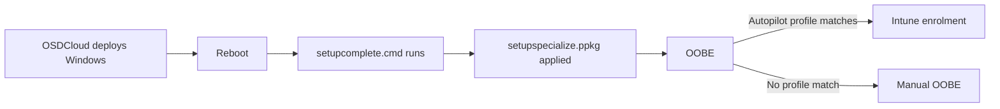

# Hand Off to Autopilot and OOBE

## When to use this

You want the deployed device to land **at OOBE ready for Intune /
Autopilot enrolment**, rather than at a workgroup-joined desktop. This is
the standard pattern for handing a freshly imaged device to an end user.

## Why this works

OSDCloud installs Windows but does not run OOBE — OOBE runs on the first
boot from disk. That gap is the natural integration point for Autopilot:



Autopilot enrolment requires the device's hardware hash to be uploaded to
Intune **before** OOBE. There are two common paths:

1. **Pre-registered devices** — vendor uploaded the hash at purchase. Just deploy and let OOBE find the profile.
2. **Self-registration** — deploy with a script that collects the hash and uploads it during the staging window. The `WindowsAutopilotIntune` and Microsoft Graph modules support this.

## Prerequisites

- An Intune tenant with an Autopilot deployment profile assigned.
- For self-registration: an app registration with the
  `DeviceManagementServiceConfig.ReadWrite.All` Graph permission.

## How OSDCloud sets up the handoff

Two pieces ship in the OSDCloud module:

| File | Role |
|---|---|
| `OSDCloud/core/setupspecialize/setupspecialize.ppkg` | Provisioning package applied at `Specialize` to set OOBE registry values |
| `OSDCloud/core/setupspecialize/setupspecialize.xml` | Source XML the PPKG was built from — edit this and rebuild the PPKG to customize |
| `OSDCloud/core/setupspecialize/customizations.xml` | Additional WCM customizations |

The OEM driver pack staging step (step 24) also writes commands into
`C:\Windows\Setup\Scripts\setupcomplete.cmd` so OEM drivers install
during Specialize without blocking OOBE.

## How to enable Autopilot-related modules on the deployed image

Steps 33–37 in the workflow stage PowerShell modules onto the offline
image so they are available at first boot. They ship with `"skip": true`.
Turn them on in `workflow/default/tasks/osdcloud.json` for the channel you use:

```jsonc
{ "name": "Save PowerShell Module WindowsAutopilotIntune",           "command": "step-powershell-savemodule", "parameters": { "name": "WindowsAutopilotIntune" },           "skip": false },
{ "name": "Save PowerShell Module Microsoft.Graph.Authentication",   "command": "step-powershell-savemodule", "parameters": { "name": "Microsoft.Graph.Authentication" },   "skip": false },
{ "name": "Save PowerShell Module Microsoft.Graph.Identity.DirectoryManagement", "command": "step-powershell-savemodule", "parameters": { "name": "Microsoft.Graph.Identity.DirectoryManagement" }, "skip": false },
{ "name": "Save PowerShell Module Microsoft.Graph.Groups",           "command": "step-powershell-savemodule", "parameters": { "name": "Microsoft.Graph.Groups" },           "skip": false }
```

After deployment those modules are in `C:\Program Files\WindowsPowerShell\Modules\`
and `Get-AutopilotInfo` is callable from a first-boot script.

## Pattern A — pre-registered device

1. Vendor (or your purchasing process) uploaded the hardware hash to Intune.
2. Deploy with OSDCloud normally:
   ```powershell
   Deploy-OSDCloud
   ```
3. Reboot.
4. OOBE starts → detects the matching Autopilot profile → enrols silently.

No extra customization is required.

## Pattern B — collect and upload hash from WinPE

Add a step to your main command (in a USB profile — see
[guide 6](06-unattended-usb-profile.md)) that runs after the deployment:

```jsonc
{
  "InvokeMainCommand": [
    "Show-OSDCloudDeviceInfo",
    "Deploy-OSDCloud -CLI",
    "https://raw.githubusercontent.com/contoso/autopilot/main/Register-DeviceWithIntune.ps1"
  ]
}
```

The registration script (your own) authenticates to Graph, calls
`Get-AutopilotInfo`, and posts to
`/deviceManagement/importedWindowsAutopilotDeviceIdentities`. After upload,
reboot — OOBE finds the profile.

## Pattern C — manual OOBE, no Autopilot

Just deploy. OOBE walks the operator through region, keyboard, network,
account. No additional configuration is needed.

## Interactive technician menus (recast-winui-dark)

Both `recast-winui-dark` tasks enable `step-update-oobemenu`. During WinPE
deployment it copies the self-contained
`OSDCloud/core/oobe/Show-OSDCloudOOBEMenu.ps1` into
`C:\Windows\Setup\Scripts` and **prepends** a synchronous invocation to both
`OOBE.cmd` and `SetupComplete.cmd`. Each menu runs before the original commands,
including driver installation. Original batch content is preserved byte-for-byte;
repeated staging refreshes managed blocks without duplicating them. Previously
appended OOBE menu blocks are moved to the beginning.
Other workflows do not enable this step.

The menu uses inbox Windows PowerShell 5.1 and WPF on AMD64 or ARM64; it does
not require the OSDCloud module, PowerShell 7, PsExec, ServiceUI, or downloads.
The batch invocation selects native Windows PowerShell (using Sysnative when
needed) and runs the equivalent of:

```cmd
"%SystemRoot%\System32\WindowsPowerShell\v1.0\powershell.exe" -NoLogo -NoProfile -STA -ExecutionPolicy Bypass -File "%SystemRoot%\Setup\Scripts\Show-OSDCloudOOBEMenu.ps1" -Phase OOBE
```

`SetupComplete.cmd` uses the same script with `-Phase SetupComplete`. Its title is
**OSDCloud SetupComplete Menu**; the first menu is **OSDCloud OOBE Menu**.
Both open 20 device-independent pixels inward from the top-left of the primary
work area (reduced when needed to keep the window on-screen), with BootMenu-style
caption controls and a collapsible left sidebar.

- **Cmd Prompt** and **Windows PowerShell** on the left open independent SYSTEM shells.
- **Open oobe.cmd** and **Open setupcomplete.cmd** open those scripts in Notepad.
  Save edits before continuing. Windows command processing may already have read
  parts of the current batch file; do not assume editing it changes the active run.
- **Date, Time & TimeZone** is available only in SetupComplete. Select a local
  calendar date, enter 24-hour `HH:mm:ss`, select a Windows time zone, then **Apply**.
  The selected zone is applied first and the chosen local time is converted to the
  correct UTC instant for that zone. Input is validated before changes; daylight-saving
  gaps/repeated hours are rejected. Errors remain visible. If setting the time
  fails after the time zone changed, inspect the clock/zone before retrying.
- **Continue Windows Setup**, Escape, Alt+F4, or closing the window returns
  **exit code 0**. Remaining batch commands can then run and setup can continue.
- Shell and Notepad windows remain open after menu closure and are not waited on.
- A shell-launch error is displayed without closing the menu.
- Startup failure returns nonzero and is logged; the appended batch block reports
  it and continues instead of deliberately stopping setup.

**Security:** this is a technician feature that deliberately exposes SYSTEM
shells, setup script editing, and clock changes. Disable both menus for unattended or end-user deployments by setting
`"skip": true` on `step-update-oobemenu` in the selected dark-workflow task
**before deployment**. Editing the task afterward does not remove an already
staged invocation.

Diagnostics are in `%SystemRoot%\Temp\osdcloud-logs\OOBEMenu.log`, including
identity, session, window station, desktop, child readiness, and exit status.
Setup's own logs can be consulted to establish the actual hook/order.
SYSTEM alone does not imply a visible desktop. If necessary, the script launches
itself as SYSTEM in the active console session and attaches to that session's
input desktop before loading WPF. It does not force a desktop switch, log on a
user, or change OOBE configuration. A child that cannot acknowledge a visible
window within 60 seconds fails instead of leaving an invisible menu blocking
setup; a visible menu has no operator timeout.

For an inert **local console** preview, use:

```powershell
powershell.exe -NoLogo -NoProfile -STA -File .\OSDCloud\core\oobe\Show-OSDCloudOOBEMenu.ps1 -Preview -Phase OOBE
powershell.exe -NoLogo -NoProfile -STA -File .\OSDCloud\core\oobe\Show-OSDCloudOOBEMenu.ps1 -Preview -Phase SetupComplete
```

Preview runs as the current user, reports shell/Notepad launches and clock changes
without executing them, and writes diagnostics
to `%TEMP%\OOBEMenu.log`. It does **not** verify first-boot behavior.

**Deployment validation is required:** this repository creates `OOBE.cmd`, but
that file's presence alone does not establish whether/when the installed Windows
build invokes it, or prove an interactive setup desktop is available. Validate
the actual SYSTEM hook on disposable AMD64 and ARM64 Windows 11 installations:
the menu must be visible and keyboard/mouse interactive, setup must wait while
it is open, both shells must work, and closing with shells still open must allow
setup to proceed normally. Also test missing assets and unavailable desktops.
Confirm the SetupComplete menu runs before its original commands, then verify
date, time and time zone changes and normal continuation after its closure.
Collect `OOBEMenu.log`, the staged `OOBE.cmd` and `SetupComplete.cmd`,
`C:\Windows\Panther\setupact.log`, and
`C:\Windows\Panther\UnattendGC\setupact.log` if a menu does not appear or setup
does not continue. SetupComplete can be disabled by Windows for OEM product keys
on non-Enterprise client editions; staging its file does not override that restriction.
No AMD64/ARM64 first-boot verification is implied by the desktop preview or mocks.
If the selected build does not invoke this hook, the menu will not appear;
do not silently substitute first logon for the requested setup hooks.

## Customize OOBE settings

Edit the source XML, rebuild the PPKG with the Windows Configuration Designer,
and replace `OSDCloud/core/setupspecialize/setupspecialize.ppkg`. Common
edits:

- Skip the EULA page (the `Hotfix for Setup Displayed Eula` workflow step already sets `SetupDisplayedEula = 1` so this is normally handled).
- Set a default keyboard or time zone before OOBE shows.
- Disable Cortana / privacy pages for kiosk scenarios.

## What this guide is **not**

A complete Autopilot setup guide. For Intune profile creation, assignment
groups, and ESP behaviour see:

- [Microsoft Learn — Windows Autopilot deployment](https://learn.microsoft.com/autopilot/)
- [Microsoft Learn — Enrolment Status Page](https://learn.microsoft.com/autopilot/enrollment-status)

## Next

- [Troubleshoot](09-troubleshooting.md) if the device lands at OOBE without joining Intune.
